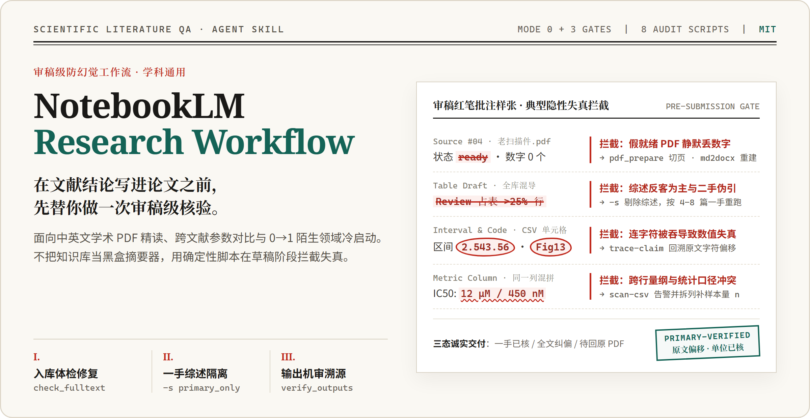
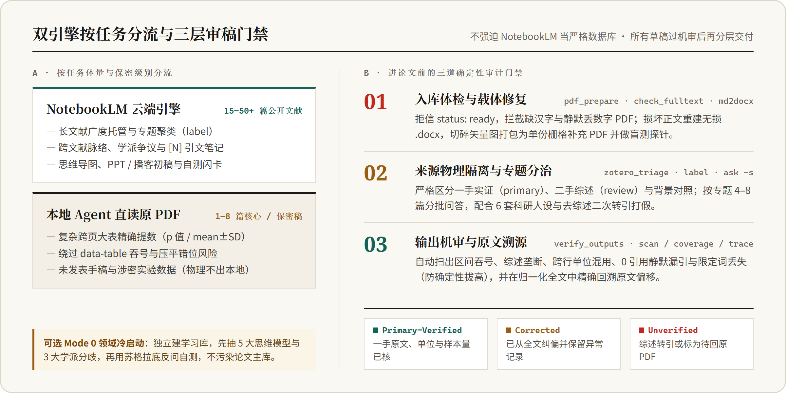

<p align="center">
  
</p>

`notebooklm-research-workflow` 是一个面向科研文献精读与质量控制的 **Agent Skill**，与基础 `notebooklm` Skill 互补。装进 Antigravity、Claude Code、Codex、Cursor 等支持 Skill 的 Agent 后，用自然语言就能调用；它在文献结论进入综述或论文写作前，自动补上**入库体检、来源隔离、输出机审**三道门禁，学科通用（生物医学、计算机/AI、化学材料、地学、社科均可直接使用）。

不是每次都要走完所有步骤。只精读 1–8 篇核心论文、需要复现原论文复杂多栏大表，或者处理未发表手稿时，直接让本地 Agent 读原 PDF，不用传云端；只想从 0 到 1 摸清一个陌生领域，单开 **Mode 0 冷启动**就行；只有批量读十几到几十篇公开文献、出参数对比表和综述时，才需要完整防线。

## 它解决什么问题

直接把一堆中英文论文丢进 NotebookLM 出表、写综述，最容易踩的不是“报错”，而是表面通顺、实则写进论文会出事故的隐性失真。下面每一条都对应流程里的具体做法：

- **状态明明显示 `ready`，中文老扫描 PDF 里的数字或汉字却悄悄丢光了。** `pdf_prepare.py` 和 `check_fulltext.py` 会直接查字库编码、字体噪声和正文数字密度；正文损坏时用 `md2docx.py` 无损重建，矢量图被裁碎则用 `pack-figs-pdf` 打包成单份栅格补充 PDF，再用 `figure_probe.py` 盲测确认 AI 真能读出图里数值。
- **全库混进一两篇综述，对比表大半被它霸占，还缝合出假引文。** 入库前先分清一手实证（`primary`）、二手综述（`review`）和背景参考（`background`），做参数表和核心实证对比时用 `-s` 物理隔离综述；如果文献在 Zotero 里，可以先用 `zotero_triage.py` 自动筛出干净白名单。
- **一次喂了十几篇论文，AI 回答时却只反复引其中一两篇，其余数据被静默冷落。** 先用 `label generate` 按专题分组，每组 4–8 篇一手文献分批提问；答完用 `verify_outputs.py check-coverage` 查出 0 引用的漏网文献，顺带检查回答有没有删掉原文里的“可能 / 初步”限定词（防确定性拔高）。
- **导出的参数对比表会吞连字符，还会把不同单位混在同一列。** 哪怕提示词写死“严禁吞号”，导出的 CSV 仍可能把区间粘成 `2.543.56`、把编号粘成 `Fig13`，或者在同一列混拼 `μM` 与 `nM`、`mean±SD` 与 `median`。`verify_outputs.py scan-csv` 会自动把这些异常全部扫出来，再用 `trace-claim` 回原文偏移核对。
- **想快速入门一个陌生学科，让 AI 逐篇总结看完还是抓不住骨架。** 可选开启 **Mode 0 跨领域冷启动**（单独建库，不混入论文主库）：先从教材和核心综述里提炼 5 个底层思维模型与 3 大学派分歧，再切到苏格拉底导师模式出题拷问——答错时不直接给答案，只抽原文线索反问引导。

## 双引擎分流与三层审稿门禁

不同任务走不同通道，所有输出草稿必须过确定性机审后再按核验程度分层交付：

<p align="center">
  
</p>

所有经过机审的输出，交付时都会按核验程度拆成三档，不把草稿当定论：

- **Primary-Verified**：已回溯一手原文偏移、样本量 `n`、单位与实验条件，可直接引用。
- **Corrected**：已从全文纠偏，并保留原本的异常记录方便复查。
- **Unverified**：仅来自综述转引或尚未核对原 PDF，显式标为“待回原 PDF 核对”。

## 安装

前置要求：Python `>= 3.10`，已安装并登录 [`notebooklm-py`](https://github.com/teng-lin/notebooklm-py)（建议同时安装基础 `notebooklm` Skill；Zotero 分诊与核验卡写回为可选功能，需额外配置 Zotero MCP）。

### 1. 放进 Agent 的 Skill 目录

- **项目级（推荐，可随仓库共享）**：`<your-project>/.agents/skills/notebooklm-research-workflow/`
- **用户全局级**：
  - Antigravity / 通用 `.agents` 规范：`~/.agents/skills/notebooklm-research-workflow/`
  - Claude Code：`~/.claude/skills/notebooklm-research-workflow/`

### 2. 安装依赖并检查登录态

```bash
pip install -r requirements.txt
# 或使用 uv：uv pip install -r requirements.txt

notebooklm login
notebooklm auth check --test --passive --json
```

排查登录态务必带上 `--test --passive`：不带 `--test` 只检查本地 Cookie 文件在不在，会话过期也会假通过；`--passive` 保证探测严格只读、不改写本地凭证。

## 怎么用

装好后不用背脚本参数，直接用自然语言告诉 Agent 你想干什么，它会按 [SKILL.md](./SKILL.md) 自动路由和调用脚本：

```text
用 notebooklm-research-workflow 处理 ./papers/ 里的 20 篇文献：
先做本地 PDF 体检，把坏字库和切碎矢量图的文献挑出来修好，
一手实证和综述分开建组入库，再按专题做参数对比表并跑完 verify_outputs 机审。
```

```text
帮我审一下刚才导出的 data-table.csv 和 ask_output.json：
跑 verify_outputs.py 检查吞号、跨行单位混用、静默漏引和确定性拔高，
有异常的条目直接用 trace-claim 回原文核对并分层标出来。
```

```text
开启 Mode 0 领域冷启动，用 ./textbooks/ 里的教材和综述单独建一个学习库：
别逐篇总结，先帮我提炼 5 个核心思维模型和 3 大学派争议，
然后切到苏格拉底导师模式出 8 道高难度诊断题考我，我答错时别直接剧透答案。
```

```text
从我的 Zotero 馆藏里拉取这个专题的文献，先用 zotero_triage.py 筛除笔记、综述和待修扫描件；
核验完核心结论后，只把 Primary-Verified 的结果幂等写回 Zotero 核验卡。
```

## 适用边界与注意事项

- **保密边界**：未发表手稿、同行评审稿和涉密实验数据默认不上传云端 NotebookLM，走本地 Agent 直接读原 PDF。
- **DOCX 内嵌图的视觉限制**：实测 NotebookLM 对 `.docx` 内嵌图片的像素级视觉索引不可靠；因此正文与表格修复走 `md2docx.py`，需要 AI 看图提数的图表统一走 `pdf_prepare.py pack-figs-pdf` 打包成单份栅格 PDF。
- **长 PDF 的 Markdown 导出可能截断**：`source fulltext --format markdown` 在长文献末尾（尤其是参考文献前）可能提前截断；原文回溯（`trace-claim`）以完整纯文本 `source fulltext` 为准。
- **账号与 Cookie 安全**：个人主力 Google 账号切勿使用 `notebooklm login --master-token`（会产生全账号高权限凭证）；Windows 下如果 Chrome 正在运行，`--browser-cookies chrome` 会因数据库锁失败，掉线后直接运行 `notebooklm login` 复用独立 `browser_profile` 即可。
- **Zotero 写回无污染**：写回核验卡前会先检查已有笔记，重复运行走幂等更新，不覆盖你自己的旧笔记，也不给子笔记打父论文标签。

<details>
<summary>配套脚本、目录结构与内置科研人设</summary>

### 8 个脚本与 2 份参考手册

- **`scripts/pdf_prepare.py`**：本地 PDF 编码/数字层诊断（`inspect`）、渲染页面、裁图、原位补图（`patch-fig`）与图件打包栅格 PDF（`pack-figs-pdf`）。
- **`scripts/check_fulltext.py`**：按语种审计入库后 `source fulltext` 的中文丢失、PDF 字体噪声、控制符与静默丢数字。
- **`scripts/export_md_figures.py`**：导出 NotebookLM 解析后的 Markdown 与实际切出的 `figures/` 图件切片，排查矢量图是否被裁碎。
- **`scripts/md2docx.py`**：将转录或 OCR Markdown（含表格与插图）无损重建为无字体噪声的 `.docx`。
- **`scripts/figure_probe.py`**：图件盲测探针——先确认 `source fulltext` 零正文泄漏，再验证 `ask -s` 能否真正读懂图内数值。
- **`scripts/verify_outputs.py`**：输出确定性机审，含 `scan-csv`（吞号/综述垄断/对象漂移/单位与统计口径混用）、`check-coverage`（静默漏引/确定性拔高）与 `trace-claim`（归一化原文偏移回溯）。
- **`scripts/zotero_triage.py`**：（可选）Zotero 馆藏入库前分诊门禁，自动过滤笔记/综述/跑题项并前置拦截待修扫描件。
- **`scripts/download_webpages.py`**：探测并批量下载 NotebookLM Studio 生成的交互式 HTML 网页（`type=10` File 产物）及 `manifest.json`。
- **`references/research-prompts.md`**：6 套跨学科科研人设（审稿人核查 / 综述脉络 / 基金评审 / 答辩挑刺 / 科普编导 / 苏格拉底导师）、Mode 0 五步提示词与去综述打假模板。
- **`references/budget-tiers.md`**：按研究目标选工具的速查表与配额消耗参考。

### 目录结构

```text
notebooklm-research-workflow/
├── SKILL.md                  # Agent 触发规则、Mode 0 冷启动与 5 步标准工作流
├── README.md                 # 使用与安装说明
├── LICENSE                   # MIT 开源协议
├── requirements.txt          # Python 第三方依赖清单
├── .gitignore                # Git 忽略规则
├── assets/readme/            # README 视觉资产（@2x WebP 成品 + source/ 可编辑源）
├── references/               # 6 套科研人设、提示词模板与配额路由参考
└── scripts/                  # 8 个入库体检、修复、机审与导出脚本
```

### 命令行快速自检

```bash
python scripts/pdf_prepare.py --help
python scripts/check_fulltext.py --help
python scripts/export_md_figures.py --help
python scripts/md2docx.py            # 打印位置参数用法（exit 2）
python scripts/figure_probe.py --help
python scripts/verify_outputs.py --help
python scripts/zotero_triage.py --help
python scripts/download_webpages.py --help
```

</details>

## License

本 Skill 的文档、视觉资产与脚本采用 [MIT License](./LICENSE) 开源。

运行辅助脚本需自行安装 `requirements.txt` 中的第三方 Python 库；其中 `pymupdf` 与 `pymupdf4llm` 由 Artifex 提供并采用双许可（AGPL-3.0 或商业许可），`notebooklm-py`、`python-docx` 遵循其各自上游开源协议。
